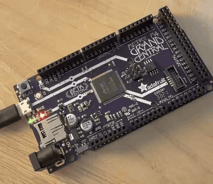

# SAMD51 Firmware Journal

Notes and firmware experiments for learning ARM Cortex-M4F microcontroller programming on the Adafruit Grand Central M4 (ATSAMD51P20A), following Microchip University's [Getting Started with Writing Code for Microchip Arm Cortex MCUs](https://mu.microchip.com/getting-started-with-writing-code-for-the-microchip-arm-cortex-microcontrollers). Preparation for firmware work on the wireless Miniscope Zero in UCLA's Aharoni Lab.



## Contents

| Document | Topics | Status |
|----------|--------|--------|
| [Lesson 01: Microcontroller basics](lessons/01-microcontroller-basics.md) | Clock domains, device headers, `SYNCBUSY`, DFLL, GPIO registers, NVIC, timer counters | Complete |
| [01 · LED blink](projects/01-led-blink/README.md) | Arduino calls and direct `PORT` register writes (`OUTTGL`) | Runs on hardware; timing not measured |

## Requirements

- **Hardware.** Adafruit Grand Central M4 Express (ATSAMD51P20A, Cortex-M4F, 120 MHz, 1 MB Flash, 256 KB SRAM) and a USB data cable.
- **Software.** Arduino IDE 2.x or Arduino CLI with the Adafruit SAMD Boards core.

## Run the blink

```bash
arduino-cli core update-index --additional-urls https://adafruit.github.io/arduino-board-index/package_adafruit_index.json
arduino-cli core install adafruit:samd@1.7.17 --additional-urls https://adafruit.github.io/arduino-board-index/package_adafruit_index.json
arduino-cli compile --fqbn adafruit:samd:adafruit_grandcentral_m4 projects/01-led-blink/src/blink
arduino-cli upload --port COM7 --fqbn adafruit:samd:adafruit_grandcentral_m4 projects/01-led-blink/src/blink
```

Replace `COM7` with the port from `arduino-cli board list`. The sketch toggles the red `L` LED (D13 / PB01) with a 500 ms delay. Arduino IDE steps and troubleshooting are in the [blink README](projects/01-led-blink/README.md).

## Project structure

- `lessons/` — Microchip University notes, one file per lesson
- `projects/01-led-blink/` — LED blink Arduino sketch and setup guide
- `images/` — README media

## Next

- Measure blink timing with an oscilloscope
- Step through the blink with an Atmel-ICE (SWD)
- Lesson 02

## References

- [Adafruit Grand Central M4 guide](https://learn.adafruit.com/adafruit-grand-central)
- [SAM D5x/E5x family datasheet](https://www.microchip.com/content/dam/mchp/documents/MCU32/ProductDocuments/DataSheets/SAM-D5x-E5x-Family-Data-Sheet-DS60001507.pdf)
