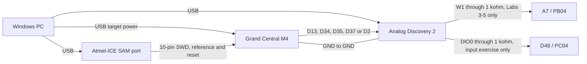

# Wiring reference and equipment checklist

## Required before assuming a complete bench

| Item | Needed for | Availability |
| --- | --- | --- |
| Grand Central M4, Atmel-ICE, AD2, Windows PC | All labs | User-reported equipment; physical condition unverified |
| Correct USB data cables for board, ICE and AD2 | Power/host links | Confirm connector type and data capability |
| Atmel-ICE SAM-compatible 10-pin 1.27 mm probe cable | SWD | Confirm kit includes it; not an AVR 6-pin ISP cable |
| Installed/mating 2×5 1.27 mm SWD header or suitable adapter | Board debug connection | Inspect your board and cable; do not assume all kits have adapters |
| AD2 2×15 flywire harness | Measurements and stimulus | Confirm present and correctly labelled |
| Breadboard/jumpers or appropriate clips | Headers and ground | Confirm available; avoid loose clips on fine-pitch SWD pins |
| Two 1 kΩ resistors | Series protection for W1→A7 and DIO0→D48 | Required for the stimulus procedures here; obtain if absent |
| Momentary normally-open button | Manual switch exercise | Optional alternative to AD2 Static I/O/Patterns |
| Extra LED plus 1 kΩ series resistor | Optional visible second LED / PWM brightness | Optional; AD2 observation needs neither |
| Multimeter or suitable breakout/continuity method | Cable pin verification | Recommended; not assumed available. Use known keyed wiring and AD2 DC measurement for voltage, never a guessed cable orientation |

## Shared connections

Connect grounds first with power off. Keep the AD2 Supplies instrument disabled; leave V+, V− and W2 unconnected. Supply the board using USB. Configure and measure an AD2 source while disconnected from the MCU, stop it, connect the series resistor and input, power/check the board, then start the source. Stop sources before resetting/powering down or disconnecting board power. AD2 inputs tolerate a wider range than the MCU; that does not make AD2 outputs automatically safe for the MCU.

## Input alternatives

**Button:** D48 → 1 kΩ → normally-open button → GND. The firmware enables the internal pull-up. No board reset connection is involved.

**AD2 digital replacement:** DIO0 → 1 kΩ → D48; AD2 GND → board GND. Static I/O high means released, low means pressed. Alternatively use a 0.5 Hz push-pull pattern with a 50% duty cycle (one second per level). D48 is always an input in these builds. Never drive a pin simultaneously from AD2 and firmware.

**Analog replacement:** W1 → 1 kΩ → A7, AD2 GND → board GND. Set a verified waveform between 0.2 and 2.2 V. This substitutes a controlled voltage for the original light sensor, not an emulation of its optical response.

Detailed connections: [Atmel-ICE](atmel-ice.md), [AD2 instruments and settings](analog-discovery-2.md), [board labels](grand-central-m4.md).
