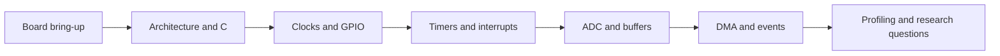

# Learning roadmap

Each stage has a concrete exit criterion. Every box starts unchecked; update only after recording evidence. These are planned study topics, not a claim about the syllabus or completion of a course.

| Stage | Evidence to collect | Entry point |
| --- | --- | --- |
| Board bring-up | Tool versions, selected board, successful upload, observed LED | [LED blink](projects/led-blink.md) |
| Architecture & C | Memory map sketch, build artifact explanation, small C exercise | [MCU basics](microchip-university/01-microcontroller-basics.md) |
| Clocks & GPIO | Clock tree and verified pin mapping | [Clock system](microchip-university/02-clock-system.md), [GPIO](microchip-university/03-gpio.md) |
| Timers & interrupts | Register sequence, interval trace, interrupt latency definition | [Timer LED](projects/timer-interrupt.md) |
| ADC & serial I/O | Defined sample cadence, bounded buffer, reliable data export | [ADC sampling](projects/adc-sampling.md) |
| DMA & Event System | Descriptor/buffer plan, completion behavior, overrun checks | [DMA benchmark](projects/dma-benchmark.md) |
| Profiling & research | Comparable runs and a scoped optimization question | [Resources](reference/resources.md) |

## Progress log

- [ ] Establish the board and development-tool baseline.
- [ ] Write the first Microchip University lesson in my own words.
- [ ] Compile, flash, and observe LED blink on the Grand Central M4.
- [ ] Explain the clock path and GPIO registers used by one pin.
- [ ] Implement and measure a timer interrupt experiment.
- [ ] Acquire and validate a periodic ADC buffer.
- [ ] Export repeated polling, interrupt, and DMA measurements.
- [ ] Inspect Miniscope Zero firmware with advisor guidance and record a verified system map.

## Research bridge

Questions to revisit after gaining fundamentals: Which tasks have deadlines? Where is data buffered? What limits transfer throughput? Which observations require a profiler or logic analyzer? Record answers only after inspecting the actual firmware and hardware configuration.
