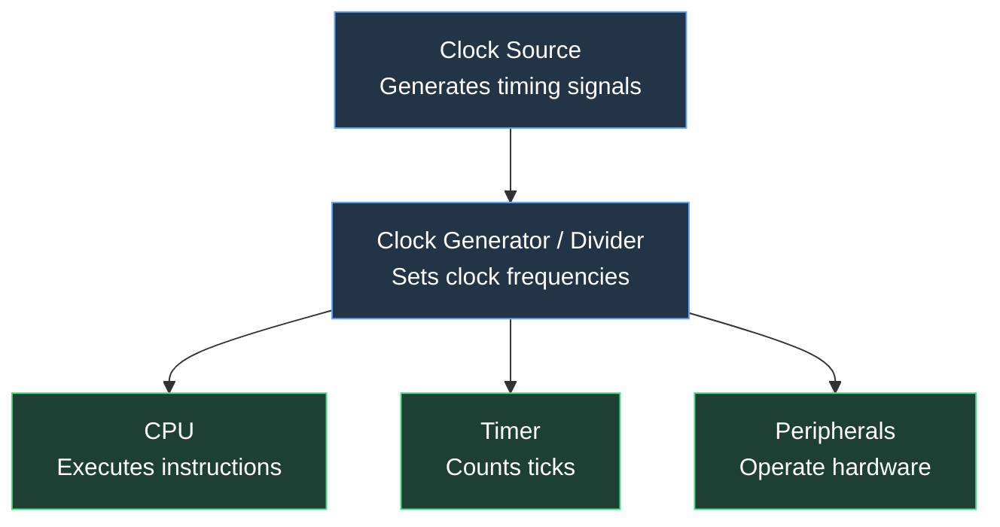

# Microcontroller basics

**Status:** In Progress

**Study date:** 14-Nov-2026

## Overview

1. Clock Domains and Bus Types
2. Compiler Header File Structure

## Key Concepts

### 1. Clock Domains and Bus Types
Clocks control hardware timing and buses allow different components of the microcontroller to communicate.
- **Clocks determine how fast hardware operates.** A clock generates periodic signals that synchronize operations.
- **Different components can use different clock frequencies.**
- **Clock domains group hardware operating from particular clock signals.** Different domains allow components to operate at different frequencies, helping balance performance and power consumption.
- **Clock generators and dividers control clock frequencies.** They derive appropriate frequencies from clock sources for different parts of the microcontroller.
- **Peripherals require appropriate clock configuration.** A peripheral may not work if its clock is disabled or incorrectly configured.
- **Buses allow hardware components to communicate.** They transfer data, addresses, and control information between the CPU, memory, and peripherals.

#### Clock Distribution



#### Significance
- **Timing:** Generating precise signals to synchronize image acquisition and other hardware operations.
- **Performance:** Understanding how CPU frequency, peripheral clocks, and bus bandwidth influence execution speed.
- **DMA:** Transferring data between memory and peripherals without requiring the CPU to perform every transfer.
- **Peripheral configuration:** Ensuring clocks are enabled and configured correctly for GPIO, timers, and communication interfaces.
- **Power optimization:** Reducing unnecessary clock activity to save energy.

### 2. Compiler Header File Structure
Header files let your C code access microcontroller hardware registers.
- **Header files (`.h`) contain declarations and definitions.**
- **`#include <xc.h>` provides access to device-specific definitions.**
- **Hardware registers are memory-mapped.** Each register exists at a specific address, and header files give you readable names to access them.
- **Structs and pointers organize peripheral registers.** For example, `OSC32KCTRL_REGS->OSC32KCTRL_STATUS` accesses the STATUS register of the oscillator control peripheral.
- **Bit masks let you manipulate individual register bits.** You can configure hardware without manually calculating every register address.

#### Significance
- **Reading firmware:** Understanding expressions like `PERIPHERAL_REGS->REGISTER`.
- **GPIO:** Finding registers that configure hardware pins.
- **Timers and interrupts:** Understanding the register definitions used to configure timing and event handling.
- **DMA:** Identifying registers and bit masks used for data transfers.
- **Debugging:** Looking up register definitions when investigating unexpected peripheral behavior.

#### C Pointers Refresher

| Symbol | Meaning | Example |
|---|---|---|
| `&` | Get address of variable | `&x` |
| `*` (declaration) | Declare a pointer | `int *p;` |
| `*` (dereference) | Access value at address | `*p` |
| `->` | Access struct member through pointer | `p->value` |
| `.` | Access struct member directly | `s.value` |
| `NULL` | Pointer that points to nothing | `int *p = NULL;` |
| `[]` | Access array element (also works with pointers) | `p[0]` |
| `void *` | Generic object pointer | `void *p;` |

#### Manipulating Bits

| Expression | Meaning |
|---|---|
| `1u << n` | Create a mask for bit `n` |
| `reg \|= mask` | Set selected bits |
| `reg &= ~mask` | Clear selected bits |
| `reg ^= mask` | Toggle selected bits |
| `reg & mask` | Test whether selected bits are set |

### 3. Synchronous and Asynchronous Clocks
The SAMD51 has different clock domains and can safely communicate between them.
- **Synchronous clocks control the CPU and system buses.** On the SAMD51, these clocks are managed by the Main Clock Controller (`MCLK`). They keep the CPU and bus interfaces operating in their respective clock domains.
- **Asynchronous clocks allow peripherals to operate independently.** The Generic Clock Controller (`GCLK`) provides clocks to peripheral cores, such as timers and ADCs. These clocks can differ in frequency from the CPU clock.
- **Many peripherals use two types of clocks.** A synchronous bus clock allows the CPU to access peripheral registers, while an asynchronous generic clock drives the peripheral's internal operation.
- **Different clock domains require synchronization.** When the CPU accesses certain registers in another clock domain, the hardware must safely transfer the information between domains.

## 4. Important Registers

**Lookup prompts:** SCB->VTOR; SysTick->CTRL/LOAD/VAL (core registers). Identify which startup code sets the vector table. Do not confuse core registers with SAMD51 peripheral registers.

| Register / field | Purpose and access semantics | Reset value / synchronization | Datasheet revision & section |
| --- | --- | --- | --- |
| To verify | To explain | To verify | To cite |

Do not write guessed addresses or bit positions. Use the matching device header; distinguish read-only, read/write, and write-one-to-clear behavior.

## 5. Code Examples

Add a small C example after verifying the target device and toolchain. Explain each relevant operation and link to the full source under `projects/`. Label incomplete snippets as illustrative and record whether they compile.

```c
/* Learning placeholder: add a verified example after completing this section. */
```

## 6. Hands-On Experiment

**Proposed experiment:** Build the blink example, locate the ELF/map files, and identify Flash versus SRAM sections without changing the bootloader.

- Hypothesis and expected behavior: to define.
- Hardware, wiring, clock configuration, and instrument: to record.
- Build / upload command and source commit: to record.
- Procedure and acceptance criterion: to define before running.
- Actual implementation, observations, raw files: not yet recorded.

## 7. Debugging Notes

| Symptom | Evidence / hypothesis | Change made | Retest outcome |
| --- | --- | --- | --- |
| No experiment run yet | — | — | — |

## 8. Connection to Miniscope Zero

**Question to investigate:** How could memory placement and startup configuration affect firmware analysis and reproducibility?

Confirm relevance by inspecting the actual project with advisor guidance. Record a public source or describe the boundary of what can be shared.

## 9. Key Takeaways

To write after study: what can I now explain, what evidence supports it, and what remains uncertain?

## 10. References

- [Starting Microchip University course](https://mu.microchip.com/getting-started-with-writing-code-for-the-microchip-arm-cortex-microcontrollers) — record the relevant module and timestamp.
- [SAM D5x/E5x family datasheet](https://www.microchip.com/content/dam/mchp/documents/MCU32/ProductDocuments/DataSheets/SAM-D5x-E5x-Family-Data-Sheet-DS60001507.pdf) — record revision, chapter title, and table/section identifiers actually consulted.
- [Grand Central M4 guide](https://learn.adafruit.com/adafruit-grand-central) — confirm board-specific assumptions.
