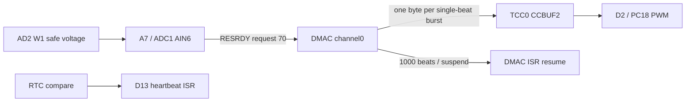

# Lab 3 · ADC-to-PWM DMA

**Status:** Complete source supplied; compiled/image-checked; electrical behavior and measurements pending.

## A. Original objective

PDF pp.66–104 configure ADC, TCC PWM and DMA between peripherals. A light sensor changes ADC1 results, which DMA writes to TCC0 channel 2's buffered compare register. A circular descriptor suspends after 1,000 beats and the DMAC ISR resumes it; RTC provides an independent heartbeat.

## B. Hardware differences

A7/PB04 is the same ADC1 AIN6 pad as the original sensor input. AD2 W1 supplies a controlled safe voltage instead of the missing light sensor. PC18 is available as Grand Central **D2**, but has no onboard LED: observe its PWM duty on AD2. The ordinary onboard D13 LED becomes the RTC heartbeat. An external LED/resistor on D2 is optional, not assumed.

## C. Required equipment

Standard SWD/power setup; AD2 flywire harness, one 1 kΩ series resistor for W1→A7, signal/ground leads. No I/O Xplained board or optical sensor is required. Have the resistor before using the stimulus procedure.

## D. Wiring

Stop AD2 sources. Connect GND→board GND, W1→1 kΩ→**A7**, Scope1+→**D2**,1−→GND. Scope2+ may monitor A7,2−→GND to verify the actual analog level at the board. Logic DIO3 can monitor D34 block markers and DIO1/D13 the heartbeat. D2 is an output: never drive it with W1/Patterns.

Configure and measure disconnected W1 before attaching it: DC1.25 V initially; later a 1 Hz triangle between0.2 and2.2 V. Board power must be present before driving A7. [AD2 procedure](../../hardware/analog-discovery-2.md#generate-a-safe-analog-input).

## E. Firmware

[Lab 3 main](https://github.com/Risa-Miura/samd51-embedded-learning/blob/main/projects/mu-labs/lab-3/main.c), shared [adc_init/pwm_init/dma_init](https://github.com/Risa-Miura/samd51-embedded-learning/blob/main/projects/mu-labs/shared/workbench.c), and the common startup/linker form the complete application.



- **PWM:** TCC0 GCLK25/APBB, NPWM, prescaler 1, PER255 and CC2 initially128. Nominal frequency48 MHz/256=187.5 kHz; buffered duty updates occur at the TCC update boundary.
- **ADC:** ADC1 GCLK41/APBD, calibrated using the device's `SW0_FUSES_REGS` masks/positions;2.5 V internal reference, AIN6,8-bit resolution, DIV256, SAMPCTRL15 and free-run. ADC clock is nominal 187.5 kHz; that is **not** the conversion throughput.
- **DMA:**16-byte-aligned descriptor and write-back objects in SRAM, BTCNT1,000, fixed source `&ADC_RESULT`, fixed destination `&TCC_CCBUF[2]`, byte beats, circular DESCADDR, block suspend, explicit **TRIGACT_BURST/BURSTLEN_SINGLE**. A conversion result request transfers one beat; it does not cause1,000 reads of one old result.
- **ISR:** DMAC_0 acknowledges SUSP, counts blocks and issues the symbolic RESUME command. TERR increments `g_dma_errors` and stops the channel. Foreground counts ADC OVERRUN flags; the counter is evidence of observed overrun incidents, not an exact count of all dropped samples.

The original low-byte DMA-to-CCBUF exercise is retained. CC2/upper bits start at zero and the 8-bit result controls a 0–255 count duty value. The CPU does not copy each ADC result into PWM. Do not keep RESULT in a live debugger watch while DMA is active: reads consume readiness. See [compatibility limits](compatibility.md#explicit-behavioral-differences).

Datasheet DS60001507N §§19.6.2,22.6.2–3,45.5.10/45.6.2/45.6.4,49.6.2.5.5/49.6.2.6. Original functions `init_TCC0`, `init_ADC`, `init_dmac`, `DMAC_0_Handler`, `RTC_Handler`, `main`.

## F. Build and flash

From the repository root, enter `projects/mu-labs` and run:

```powershell
python build.py lab-3
```

Inspect `build/lab-3/open/build-record.json` and the memory map, then follow the [Atmel-ICE identity, power, backup and connection checks](../../hardware/atmel-ice.md). Only after those checks:

```powershell
python program.py build/lab-3/open/firmware.elf --replace-application
```

This replaces the existing application, not the bootloader. Enter the offset application's reset handler using its own stack, as documented in the [debug guide](../../hardware/atmel-ice.md#attach-gdb-and-enter-the-offset-application). No physical programming was performed while writing this adaptation.

## G. Debug with Atmel-ICE

Inspect ADC CALIB/REFCTRL/INPUTCTRL/CTRLA/CTRLB/SAMPCTRL, TCC PER/CC2/CCBUF2, DMAC BASEADDR/WRBADDR/CHCTRLA/CHINTFLAG, `g_descriptor`, `g_writeback`, `g_dma_blocks`, `g_dma_errors`, `g_adc_overruns` and `g_fault_stage`. Verify descriptor/write-back addresses are divisible by 16. Pause briefly at DMAC_0_Handler to inspect SUSP, then remove breakpoints for a clean run: free-running ADC can overrun while DMA/CPU is paused or suspended.

Never edit a descriptor while DMA owns it. To test a new setting, stop/reset and rebuild, or deliberately disable/suspend and establish ownership first. The core cache is left off; do not import a Cortex-M7 data-cache recipe into this target.

## H. AD2 measurements

With verified DC1.25 V on A7, observe D2 at 50 MS/s,1 µs/div, rising threshold1.65 V. Expect a nominal 5.333 µs period and approximately 50% duty. Repeat at measured0.25 and2.25 V for roughly10/90% duty, allowing ADC/reference and quantization error. Then use the verified1 Hz triangle and watch the duty change over the slow input cycle.

Measure D34 block-marker spacing separately, record the ADC configuration, and compute the observed transfer rate as1,000/mean block interval only if blocks are continuous and overrun/error counters remain acceptable. Keep exported USB/CSV operations outside timed intervals. RTC D13 should still toggle at its nominal 1 s interval.

## I. Expected results

D2 remains a high-frequency0–3.3 V PWM whose duty follows input voltage. RTC heartbeat and DMA block counts advance. No actual conversion rate, duty error, ISR cost or CPU utilization has been measured. Low `elapsed_us` alone would not prove a utilization improvement.

## J. Troubleshooting

| Symptom | Check |
| --- | --- |
| Constant half-duty | ADC start/RESRDY, correct A7/ADC1 AIN6, DMAC request70, CHCTRLA burst action, destination CCBUF2 |
| Constant zero/full duty | Actual voltage/reference, analog PMUX, calibration, source/destination widths and upper compare bits |
| No PWM | D2=PC18/F WO2, TCC bus/generic clock, enable/reset and synchronization |
| Stops every1,000 transfers | SUSP interrupt/vector/RESUME command, circular descriptor validity |
| DMA error |16-byte alignment, SRAM location, descriptor layout/beat size, valid register addresses, channel flags |
| Input data lost | Stop live RESULT watches, remove breakpoints, examine free-run/suspend timing and OVERRUN incidents |

## K. What I learned


- Why must TRIGACT specify a one-beat burst here?
- How does CCBUF reduce PWM-update glitches compared with direct CC changes?
- Who owns the result register and descriptor at each stage?
- What is the difference between ADC clock frequency and measured conversion throughput?
- What evidence would be needed before claiming DMA reduced CPU service time?


| Date / firmware commit | Setup and raw capture | Actual observations / measurements | Unresolved issue |
| --- | --- | --- | --- |
| Not performed | Not recorded | Not measured | Hardware verification pending |

Keep expected and actual results separate. Check off the [bench verification list](verification.md) only after recording evidence for Lab 3.
