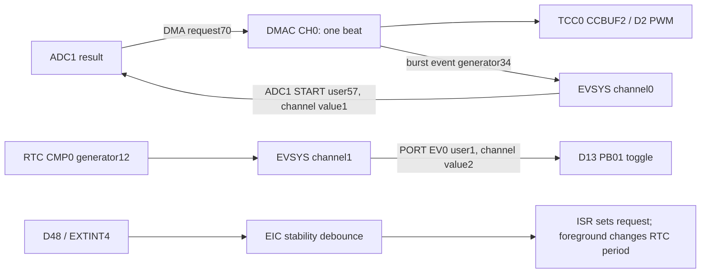

# Lab 4 · Event System and EIC debounce

**Status:** Source supplied and software-checked; peripheral event behavior is not bench-verified.

## A. Original objective

PDF pp.105–121 configure hardware event routes, replace software-controlled peripheral starts with events, and replace polled switch debouncing with EIC hardware debouncing. The original routes are **DMAC→ADC start** and **RTC→PORT toggle**, not a timer-triggered ADC substitution.

## B. Hardware differences

Keep Lab 3's A7/D2 ADC/PWM wiring. D13/PB01 receives the RTC's PORT toggle event. D48/PC04/EXTINT4 replaces PB31/EXTINT15. The EIC ISR requests a foreground change of RTC period; synchronized RTC writes are kept out of that ISR.

## C. Required equipment

Lab 3 equipment plus one 1 kΩ resistor and DIO0/button input setup. No expansion board is required. W1 stays in the verified0.2–2.2 V range; DIO0 is3.3 V digital.

## D. Wiring

W1→1 kΩ→A7; DIO0→a separate1 kΩ→D48; all grounds common. Scope1+/Logic input→D2 PWM; Logic DIO1→D13 event output; optionally DIO3→D34 DMA block marker. Board and instrument outputs must never drive one another. [Detailed map](../../hardware/wiring-reference.md).

## E. Firmware

[Lab 4 main](https://github.com/Risa-Miura/samd51-embedded-learning/blob/main/projects/mu-labs/lab-4/main.c) and shared [events_init/eic_init](https://github.com/Risa-Miura/samd51-embedded-learning/blob/main/projects/mu-labs/shared/workbench.c) implement:



Channel0 uses generator `EVENT_ID_GEN_DMAC_CH_0`, user `EVENT_ID_USER_ADC1_START`, and USER.CHANNEL=1. ADC FREERUN is removed and STARTEI is enabled. The DMA descriptor adds EVOSEL_BURST and CH0 CHEVCTRL enables event output. **One software start still seeds the first conversion**; thereafter a completed DMA beat requests the next conversion.

Channel1 routes RTC CMP0 to PORT EV0. USER.CHANNEL=2 selects event channel 1 (the user encoding is channel index+1). PB01's PORT_EVCTRL selects PID0=1, action toggle and event input0. RTC's CMPEO0 is enabled while its NVIC interrupt is **not** enabled, so no RTC ISR is required to toggle the LED. Other port groups' event inputs remain unused.

Both paths are asynchronous: per-channel EVSYS GCLKs are not required. If later choosing synchronous/resynchronized paths, use the DFP's `EVSYS_GCLK_ID_0=11`, `EVSYS_GCLK_ID_1=12`, not the manual's22/21 annotations.

EIC uses PC04 muxA/EXTINT4, GCLK1=DFLL/48,000 (~1 kHz), CONFIG0.SENSE4=FALL, DEBOUNCEN bit 4, ASYNCH=0, group 0 DIV8 and eight stable ticks. This provides nominal~64 ms stability qualification plus phase; the exact response must be measured. The EIC ISR sets `g_change_period`; foreground safely disables RTC, clears COUNT, changes COMP and reenables it for1 s or0.25 s nominal toggle intervals.

DMA still suspends after 1,000 beats and requires a CPU resume ISR. Thus the acquisition loop is not indefinitely CPU-independent. A conversion already started by the final burst event can become pending during suspend; observe block transitions/errors rather than assuming no gaps. RTC→PORT toggling demonstrates a separate CPU-free event action, while button handling and DMA block servicing still use CPU code.

Datasheet DS60001507N §§22.6.3.6,23.6.4.3,31.5.2,32.6.4,45.6.6 and corresponding register descriptions. Original functions `init_event`, `init_ports`, `init_ADC`, `init_dmac`, `init_external_interrupts`, `EIC_EXTINT15_Handler`.

## F. Build and flash

From the repository root, enter `projects/mu-labs` and run:

```powershell
python build.py lab-4
```

Inspect `build/lab-4/open/build-record.json` and the memory map, then follow the [Atmel-ICE identity, power, backup and connection checks](../../hardware/atmel-ice.md). Only after those checks:

```powershell
python program.py build/lab-4/open/firmware.elf --replace-application
```

This replaces the existing application, not the bootloader. Enter the offset application's reset handler using its own stack, as documented in the [debug guide](../../hardware/atmel-ice.md#attach-gdb-and-enter-the-offset-application). No physical programming was performed while writing this adaptation.

## G. Debug with Atmel-ICE

Inspect EVSYS CHANNEL0/1 and USER57/1; ADC EVCTRL.STARTEI and CTRLB.FREERUN=0; descriptor EVOSEL; DMAC CHEVCTRL; RTC EVCTRL.CMPEO0; PORT GROUP1 EVCTRL; EIC CONFIG0/DEBOUNCEN/DPRESCALER/PINSTATE/INTFLAG. Watch `g_dma_blocks`, `g_adc_overruns`, `g_button_events`, `g_change_period` and `g_fault_stage`.

`g_rtc_matches` remains zero because RTC's NVIC interrupt is not enabled; D13 is event-driven. A breakpoint in RTC_Handler should not be hit in the intended configuration. Halting the core can also halt peripherals according to their DBGCTRL settings, so do not use a halted-core LED observation as a standalone proof of event-path failure or autonomy.

## H. AD2 measurements

Verify D2 PWM/duty as in Lab 3. Observe D13 at a slow sample rate: stable low presses ≥250 ms should cause qualified EIC events and change its nominal toggle interval between1 s and0.25 s. Use DIO0 Pattern0.5 Hz first; then test short pulses (~10 ms) to examine rejection. Capture the input edge and LED sequence, but note that the first post-change LED interval includes foreground/synchronization/COUNT-reset phase.

To distinguish a software toggle from the intended event route, inspect the source/NVIC state and confirm D13 continues toggling with no RTC ISR enabled during **normal running**. Do not globally mask interrupts for a long acquisition and then assume DMA can pass its suspend boundary without the servicing ISR.

## I. Expected results

ADC→DMA→PWM continues after a single initial start; D13 toggles from RTC events; each qualified falling input increments `g_button_events` and changes RTC cadence. No event latency, debounce time, lost-sample count or timing improvement has been measured.

## J. Troubleshooting

- Only one ADC result: check the seed, FREERUN removal, STARTEI, DMAC EVOE/EVOSEL, generator34/user57 and channel+1 encoding.
- No event-driven LED: RTC CMPEO0, generator12, userPORT_EV0 and GROUP1 PID0=1/PORTEI0 must agree.
- Wrong button behavior: EXTINT4 uses CONFIG0/group 0 and its own NVIC vector, not CONFIG1/SENSE7/EXTINT15.
- Debounce takes too long or changes immediately: verify GCLK1 divisor, DIV8 encoding, STATES0, ASYNCH=0 and actual stimulus history.
- Acquisition stops at a block boundary: inspect SUSP/RESUME and pending conversion; do not confuse a CPU-serviced suspend with a fully autonomous chain.

## K. What I learned


- Which operations no longer require a CPU interrupt, and which still do?
- Why must the first ADC conversion be seeded?
- Why is USER channel 0 encoded as1?
- How does synchronous stability debounce differ from immediate-edge/asynchronous lockout?
- What happens at the 1,000-beat suspend boundary?


| Date / firmware commit | Setup and raw capture | Actual observations / measurements | Unresolved issue |
| --- | --- | --- | --- |
| Not performed | Not recorded | Not measured | Hardware verification pending |

Keep expected and actual results separate. Check off the [bench verification list](verification.md) only after recording evidence for Lab 4.
