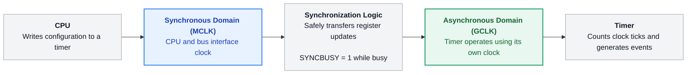
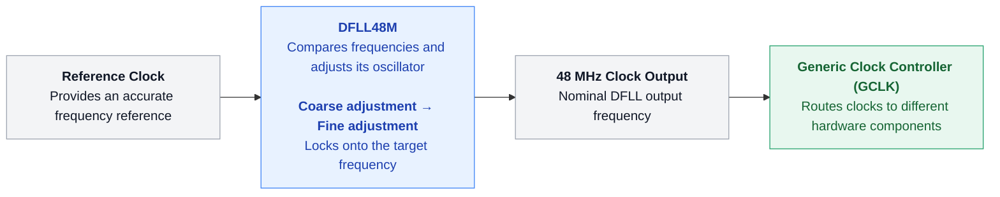
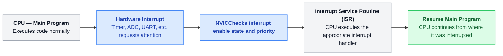

# Microcontroller basics

**Status:** Completed

**Study date:** Week 1

## Overview

1. Clock Structure
2. Compiler Specifics
3. Clock Synchronization
4. Internal Oscillator Setup
5. GPIO and Peripherals

## 1 Clock Structure 
Clocks control hardware timing and buses allow different components of the microcontroller to communicate.

### 1.1 Clock Domains and Bus Types
- **Clocks determine how fast hardware operates.** A clock generates periodic signals that synchronize operations.

- **Different components can use different clock frequencies.**

- **Clock domains group hardware operating from particular clock signals.** Different domains allow components to operate at different frequencies, helping balance performance and power consumption.

- **Clock generators and dividers control clock frequencies.** They derive appropriate frequencies from clock sources for different parts of the microcontroller.

- **Peripherals require appropriate clock configuration.** A peripheral may not work if its clock is disabled or incorrectly configured.

- **Buses allow hardware components to communicate.** They transfer data, addresses, and control information between the CPU, memory, and peripherals.

### 1.2 Significance
- **Timing:** Generating precise signals to synchronize image acquisition and other hardware operations.
- **Performance:** Understanding how CPU frequency, peripheral clocks, and bus bandwidth influence execution speed.
- **DMA:** Transferring data between memory and peripherals without requiring the CPU to perform every transfer.
- **Peripheral configuration:** Ensuring clocks are enabled and configured correctly for GPIO, timers, and communication interfaces.
- **Power optimization:** Reducing unnecessary clock activity to save energy.

## 2 Compiler Specifics
Header files let your C code access microcontroller hardware registers.

### 2.1 Compiler Header File Structure
- **Header files (`.h`) contain declarations and definitions.**

- **`#include <xc.h>` provides access to device-specific definitions.**

- **Hardware registers are memory-mapped.** Each register exists at a specific address, and header files give you readable names to access them.

- **Structs and pointers organize peripheral registers.** For example, `OSC32KCTRL_REGS->OSC32KCTRL_STATUS` accesses the STATUS register of the oscillator control peripheral.

- **Bit masks let you manipulate individual register bits.** You can configure hardware without manually calculating every register address.

### 2.2 Significance
- **Reading firmware:** Understanding expressions like `PERIPHERAL_REGS->REGISTER`.
- **GPIO:** Finding registers that configure hardware pins.
- **Timers and interrupts:** Understanding the register definitions used to configure timing and event handling.
- **DMA:** Identifying registers and bit masks used for data transfers.
- **Debugging:** Looking up register definitions when investigating unexpected peripheral behavior.

## 3. Clock Synchronization
The SAMD51 has different clock domains and can safely communicate between them.

### 3.1 Synchronous and Asynchronous Clocks
- **Synchronous clocks control the CPU and system buses.** On the SAMD51, these clocks are managed by the Main Clock Controller (`MCLK`). 

- **Asynchronous clocks allow peripherals to operate independently.** The Generic Clock Controller (`GCLK`) provides clocks to peripheral cores, such as timers and ADCs.

- **Many peripherals use two types of clocks.** A synchronous bus clock allows the CPU to access peripheral registers, while an asynchronous generic clock drives the peripheral's internal operation.

- **Different clock domains require synchronization.** When the CPU accesses certain registers in another clock domain, the hardware must safely transfer the information between domains.

- **`SYNCBUSY` indicates when synchronization is happening.** Some register operations take multiple clock cycles to complete. The CPU can check the peripheral's `SYNCBUSY` register before performing another dependent operation.

- **Not every register requires synchronization.** Some registers are accessible immediately, while others require synchronization for reads, writes, or both.



### 3.2 Example Code: Waiting for synchronization

```c
// Example for TC0 with SAMD51 CMSIS-style headers
TC0->COUNT16.CTRLA.reg |= TC_CTRLA_ENABLE;

// Wait until synchronization finishes
while (TC0->COUNT16.SYNCBUSY.bit.ENABLE) {
    // Wait
}
```
*The while loop waits until the hardware finishes synchronizing the timer's enable operation.*

*Without the necessary synchronization, subsequent register operations might happen too early or be rejected.*

### 3.3 Significance
- **Timing:** Ensuring timers and other peripherals operate at the intended frequencies.
- **Peripheral initialization:** Correctly configuring hardware registers and waiting for synchronization when required.
- **Debugging:** Understanding why a register update doesn't take effect immediately.
- **Performance:** Recognizing synchronization delays and their potential impact on firmware execution time.
- **Power optimization:** Operating peripherals at suitable clock frequencies without unnecessarily running the CPU at full speed.

## 4 Internal Oscillator Setup
An internal oscillator is a circuit built into a microcontroller that generates a repeating electrical signal used as a clock.

### 4.1 Digital Frequency Locked Loop (DFLL)
- **A DFLL generates a clock at a target frequency.** The SAMD51 has a Digital Frequency Locked Loop called `DFLL48M`, which generates a nominal 48 MHz clock.

- **A DFLL can use a reference clock for accuracy.** It compares its output frequency against a known reference and adjusts itself to maintain the desired frequency.

    - they recommend an external 32KHZ crystal for cost-efficiency
- **Open-loop mode operates without continuous reference-based correction.** The DFLL uses calibration values to generate its output frequency, but it doesn't continuously correct deviations against a reference.

- **Closed-loop mode automatically adjusts the frequency.** The DFLL uses a reference clock and continuously corrects its output to maintain a more accurate frequency.

- **Coarse and fine adjustments control frequency accuracy.** Coarse adjustment brings the clock near its target; fine adjustment improves the accuracy.

- **The DFLL needs time to achieve frequency lock.** In closed-loop mode, the hardware needs time to stabilize. Firmware can check lock-status bits before relying on the required clock accuracy.

- **The generated clock can be distributed to other hardware.** The Generic Clock Controller (`GCLK`) can use the `DFLL48M` as a clock source for the CPU clock path or peripherals.



*Illustrates closed-loop operation. Open-loop mode does not continuously use a reference clock for correction.*

### 4.2 How Frequency Multiplication Works

Suppose the DFLL uses a **32.768 kHz reference clock**.

To produce approximately **48 MHz**:

$$
f_{\text{DFLL}} = f_{\text{reference}} \times M
$$

where $M$ is the configured multiplication factor.

A multiplication factor of **1465** gives:

$$
32{,}768 \times 1465 = 48{,}005{,}120 \text{ Hz}
$$

That's approximately **48 MHz**.


### 4.3 Significance
- **Timing:** Producing clocks accurate enough for communication and synchronized hardware operations.
- **Performance:** Understanding where the microcontroller's clock frequencies originate.
- **Peripheral configuration:** Ensuring timers and communication peripherals receive suitable clock signals.
- **Debugging:** Identifying problems caused by inaccurate clocks or missing frequency lock.
- **Power optimization:** Understanding the power cost of different clock sources and configurations.

## 5 GPIO and Peripherals
An internal oscillator is a circuit built into a microcontroller that generates a repeating electrical signal used as a clock.

### 5.1 GPIO Port Control
- **GPIO stands for General-Purpose Input/Output.** GPIO pins allow the microcontroller to communicate with external hardware, such as LEDs, buttons, and sensors.

- **Pins can be configured as inputs or outputs.** An input reads an external signal, while an output drives a signal to control hardware.

- **The `DIR` register controls pin direction.** Setting a bit to `1` configures the corresponding pin as an output; `0` configures it as an input.

- **The `OUT` register controls output voltage levels.** Writing `1` drives an output HIGH, while writing `0` drives it LOW.

- **Special registers simplify GPIO operations.** `DIRSET`, `DIRCLR`, `OUTSET`, `OUTCLR`, and `OUTTGL` let you modify specific bits without affecting unrelated pins.

- **The `IN` register reads pin states.** You can determine whether an input pin is HIGH or LOW, provided its input buffer is enabled.

- **Pin multiplexing allows GPIO pins to serve other functions.** The `PMUX` and `PINCFG` registers let pins connect to hardware peripherals such as SPI, UART, timers, and ADC interfaces instead of ordinary GPIO.


#### 5.1.1 Important GPIO Registers

| Register | Purpose |
|---|---|
| `DIR` | Set pin direction (input/output) |
| `DIRSET` | Configure selected pins as outputs |
| `DIRCLR` | Configure selected pins as inputs |
| `OUT` | Set output values |
| `OUTSET` | Drive selected output pins HIGH |
| `OUTCLR` | Drive selected output pins LOW |
| `OUTTGL` | Toggle selected output pins |
| `IN` | Read input values |
| `PINCFG` | Configure input buffers, pull resistors, and peripheral selection |
| `PMUX` | Assign pins to peripheral functions |

#### 5.1.2 Example Code: Controlling GPIO Using Registers

Suppose you want to configure pin `PA00` as an output and toggle its state.

Using SAMD51 CMSIS-style register definitions:

```c
#include "sam.h"

// Configure PA00 as an output
PORT->Group[0].DIRSET.reg = (1u << 0);

// Drive PA00 HIGH
PORT->Group[0].OUTSET.reg = (1u << 0);

// Drive PA00 LOW
PORT->Group[0].OUTCLR.reg = (1u << 0);

// Toggle PA00
PORT->Group[0].OUTTGL.reg = (1u << 0);
```


#### 5.1.3 Why Use `OUTTGL` Instead of Modifying `OUT`?

Consider:

```c
// Read-modify-write operation
PORT->Group[0].OUT.reg ^= (1u << 0);
```

Versus:

```c
// Dedicated hardware toggle register
PORT->Group[0].OUTTGL.reg = (1u << 0);
```

The second approach toggles the selected output bit without a software read-modify-write sequence.

This avoids unintentionally overwriting changes to other pins made between a read and write.


#### 5.1.4 Significance
- **Hardware control:** Enabling or disabling LEDs, sensors, or other electronic components.
- **Timing:** Generating precise GPIO pulses or toggling pins to measure execution timing.
- **Debugging:** Checking whether the firmware configures and controls the correct hardware pins.
- **Peripheral configuration:** Assigning physical pins to SPI, UART, timers, and other hardware functions.
- **Performance optimization:** Understanding the difference between direct register access and higher-level GPIO functions.

### 5.2 Nested Vector Interrupt Controller (NVIC)

- **The NVIC manages hardware interrupts.** It allows peripherals such as timers, ADCs, and communication interfaces to request CPU attention without requiring constant polling.

- **Interrupts temporarily interrupt normal program execution.** When an enabled interrupt occurs, the CPU pauses its current code, executes an Interrupt Service Routine (ISR), and then resumes.

- **Interrupt priorities determine which interrupts are handled first.** On the SAMD51, there are eight programmable priority levels (0–7). Lower numbers indicate higher priority. 

- **Higher-priority interrupts can interrupt lower-priority ISRs.** This is called interrupt nesting. It allows urgent hardware events to be handled without waiting for less important interrupt handlers to finish.

- **The interrupt vector table identifies the appropriate ISR.** It contains handler addresses that the processor uses to determine which function to execute when an interrupt occurs.

- **Interrupts must be enabled and configured.** Typically, you enable the interrupt source inside the peripheral, enable its IRQ in the NVIC, and ensure interrupts are globally enabled.

- **ISRs should be short and efficient.** Long interrupt handlers can delay other processing, increase latency, and interfere with real-time operations.

#### 5.2.1 NVIC Interrupt Flow




#### 5.2.2 Significance
- **Timing:** Handling precise timer events without constantly polling.
- **Data acquisition:** Responding to sensor events and data-ready signals.
- **DMA:** Handling transfer-complete interrupts when blocks of data are ready.
- **Performance:** Reducing interrupt overhead and avoiding excessive CPU usage.
- **Debugging:** Investigating missed interrupts, incorrect priorities, and timing problems.
- **Real-time reliability:** Ensuring time-critical operations aren't delayed by less important tasks.

### 5.3 Timer Counters

- **Timer Counters (TC) count clock ticks or events.** A hardware timer increments or decrements a counter independently of normal CPU instruction execution, allowing precise timing without software delay loops.

- **A timer receives a clock from the Generic Clock Controller (`GCLK`).** The clock frequency determines how quickly the timer counts.

- **Prescalers divide the timer's clock frequency.** For example, a prescaler of 64 makes a timer receiving a 48 MHz clock count at 750 kHz.

- **Timer Counters support different bit widths.** The SAMD51 TC peripherals support 8-bit, 16-bit, and 32-bit modes. Larger counters can represent longer intervals before wrapping around.

- **Compare Match registers (`CCx`) define trigger points.** When the counter reaches a configured compare value, the hardware can generate an interrupt, event, or DMA request.

- **Overflow occurs when a counter reaches its limit.** The timer can generate an interrupt or event when it wraps around, allowing software to respond periodically.

- **Timers can generate interrupts through the NVIC.** Instead of continuously checking the counter, your program can execute an Interrupt Service Routine (ISR) when a timer event occurs.

- **Timers can operate without constant CPU intervention.** Through the Event System and DMA, timers can trigger peripheral operations with little or no direct CPU involvement.

## Programming the Board (Finally!)
Let's blink the red LED labeled `L` connected to digital pin D13 (found from [Grand Central M4 guide](https://learn.adafruit.com/adafruit-grand-central))

### Verifying board with Arduino first

```arduino
void setup() {
    pinMode(13, OUTPUT);    // configure the LED's GPIO pin as output
}

void loop() {
    digitalWrite(13, HIGH); // drive the pin high (approx 3.3 V)
    delay(500);             // wait 500 ms

    digitalWrite(13, LOW);  // drive the pin low (0 V)
    delay(500);             // wait 500 ms again
}
```
Pin name found using [Grand Central M4 Pinout Diagram](https://cdn-learn.adafruit.com/assets/assets/000/115/366/original/adafruit_products_Adafruit-Grand-Central-M4-Express-Pinout.png?1663982143)

### Controlling the registers directly

```c
#define LED_MASK (1u << 1)  // PB01 = D13

void setup() {
    // Configure PB01 as an output.
    PORT->Group[1].DIRSET.reg = LED_MASK;
}

void loop() {
    // Toggle the LED using a hardware register.
    PORT->Group[1].OUTTGL.reg = LED_MASK;

    delay(500);
}
```

## Next Steps
- measure LED timing using oscilloscope
- step through the code with the Atmel-ICE
- continue going through microchip university (get topics ranked by marcel)

## Misc Tables

#### Manipulating Bits

| Expression | Meaning |
|---|---|
| `1u << n` | Create a mask for bit `n` |
| `reg \|= mask` | Set selected bits |
| `reg &= ~mask` | Clear selected bits |
| `reg ^= mask` | Toggle selected bits |
| `reg & mask` | Test whether selected bits are set |

#### C Pointers Refresher

| Symbol | Meaning | Example |
|---|---|---|
| `&` | Get address of variable | `&x` |
| `*` (declaration) | Declare a pointer | `int *p;` |
| `*` (dereference) | Access value at address | `*p` |
| `->` | Access struct member through pointer | `p->value` |
| `.` | Access struct member directly | `s.value` |
| `NULL` | Pointer that points to nothing | `int *p = NULL;` |
| `[]` | Access array element (also works with pointers) | `p[0]` |
| `void *` | Generic object pointer | `void *p;` |

## References

- [Starting Microchip University course](https://mu.microchip.com/getting-started-with-writing-code-for-the-microchip-arm-cortex-microcontrollers)
    - Modules: Introduction, Clock Structure, Compiler Specifics, Clock Synchronization, Internal Oscillator Setup, and GPIO and Peripherals (Up to Lab 1)
- [Grand Central M4 guide](https://learn.adafruit.com/adafruit-grand-central)
    - red LED `L` connected to `D13` (search for better place to find this)
    - pinout diagram for names
- [GPIO Register Definitions](https://github.com/adafruit/asf4/blob/master/samd51/include/component/port.h)
- [Microcontroller definitions](https://github.com/adafruit/asf4/blob/master/samd51/include/samd51p20a.h)
- [SAM D5x/E5x family datasheet](https://www.microchip.com/content/dam/mchp/documents/MCU32/ProductDocuments/DataSheets/SAM-D5x-E5x-Family-Data-Sheet-DS60001507.pdf) 
    - record chapter title and table/section identifiers consulted

<!--
## 4. Important Registers

**Lookup prompts:** SCB->VTOR; SysTick->CTRL/LOAD/VAL (core registers). Identify which startup code sets the vector table. Do not confuse core registers with SAMD51 peripheral registers.

| Register / field | Purpose and access semantics | Reset value / synchronization | Datasheet revision & section |
| --- | --- | --- | --- |
| To verify | To explain | To verify | To cite |

Do not write guessed addresses or bit positions. Use the matching device header; distinguish read-only, read/write, and write-one-to-clear behavior.

## 5. Code Examples

Add a small C example after verifying the target device and toolchain. Explain each relevant operation and link to the full source under `projects/`. Label incomplete snippets as illustrative and record whether they compile.

```c
/* Learning placeholder: add a verified example after completing this section. */
```

## 6. Hands-On Experiment

**Proposed experiment:** Build the blink example, locate the ELF/map files, and identify Flash versus SRAM sections without changing the bootloader.

- Hypothesis and expected behavior: to define.
- Hardware, wiring, clock configuration, and instrument: to record.
- Build / upload command and source commit: to record.
- Procedure and acceptance criterion: to define before running.
- Actual implementation, observations, raw files: not yet recorded.

## 7. Debugging Notes

| Symptom | Evidence / hypothesis | Change made | Retest outcome |
| --- | --- | --- | --- |
| No experiment run yet | — | — | — |

## 8. Connection to Miniscope Zero

**Question to investigate:** How could memory placement and startup configuration affect firmware analysis and reproducibility?

Confirm relevance by inspecting the actual project with advisor guidance. Record a public source or describe the boundary of what can be shared.

## 9. Key Takeaways

To write after study: what can I now explain, what evidence supports it, and what remains uncertain?
-->
